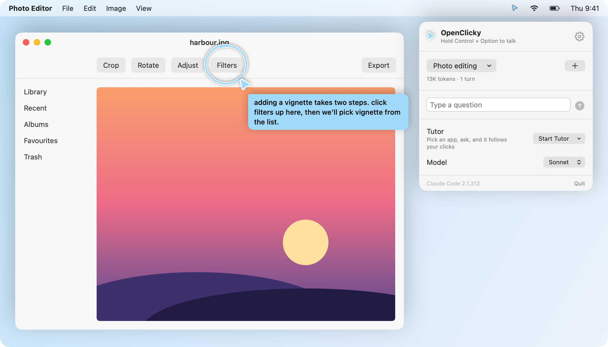
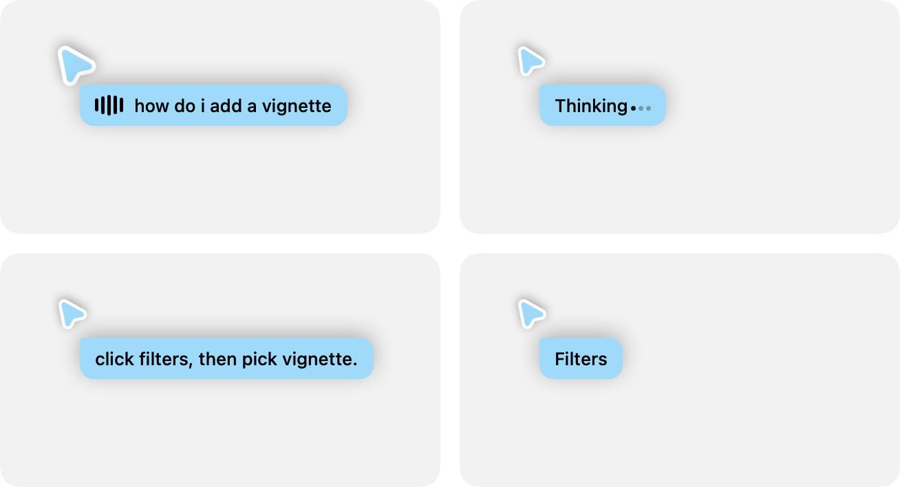
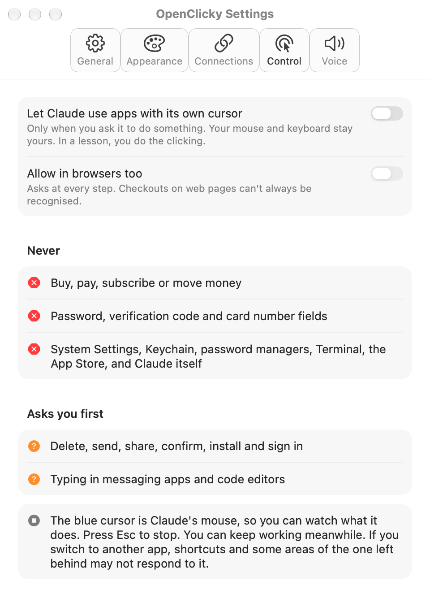
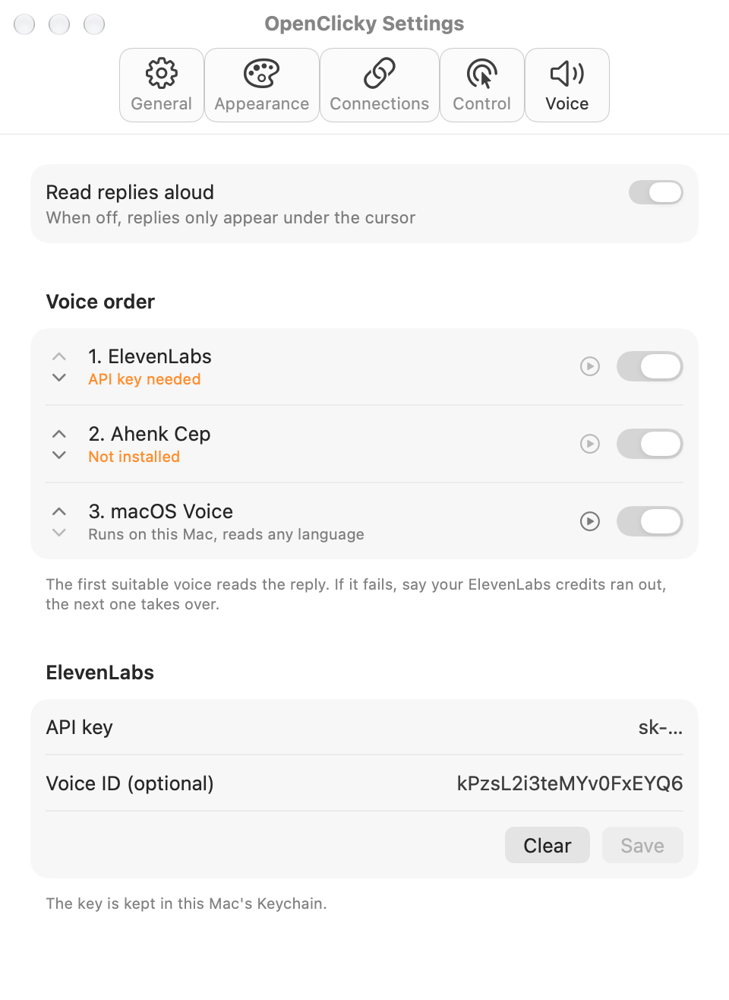
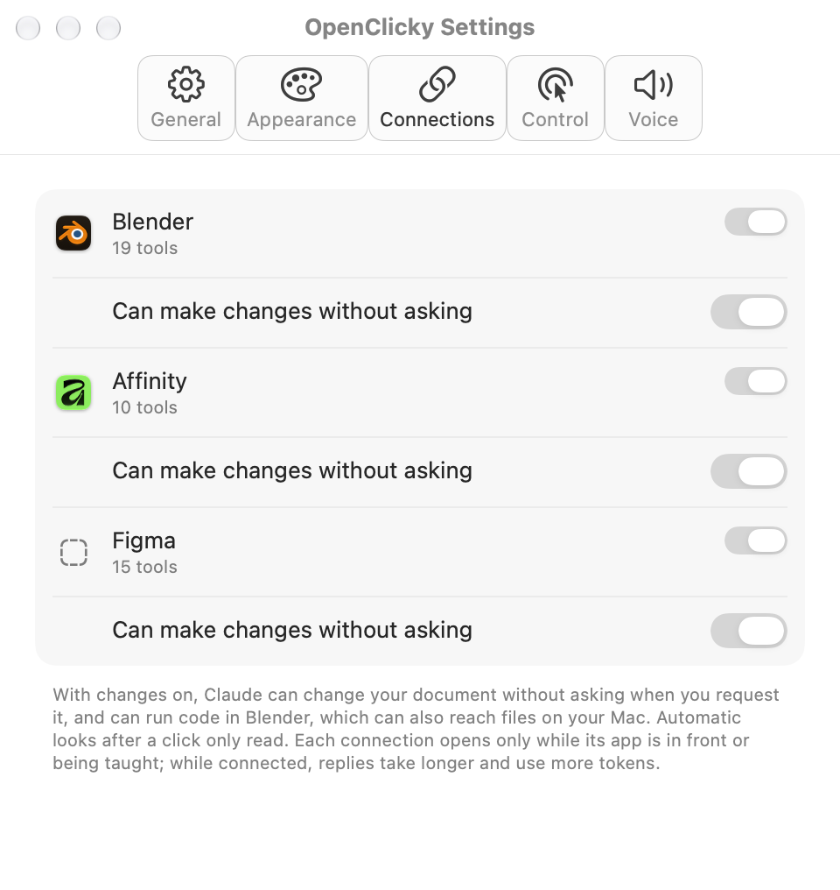
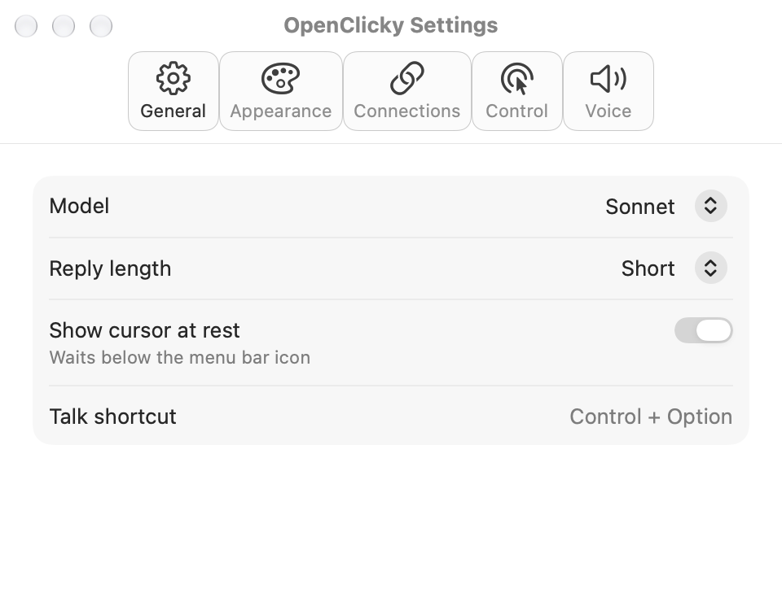
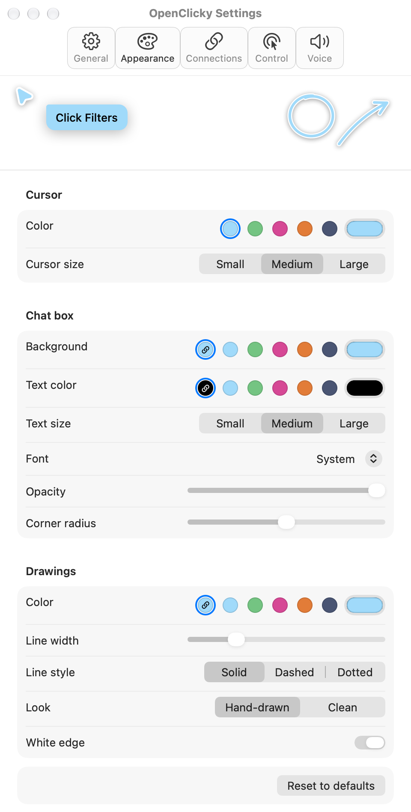

<div align="center">


# OpenClicky

**A blue cursor that sees your screen, talks you through it, and points at the answer.**

Hold a key, ask out loud, and Claude replies in a sentence or two while its cursor flies to the button you need.
It runs on your existing Claude Code login, so there are no API keys to manage.

[](#install)
[](#install)
[](native/Package.swift)
[](https://claude.com/claude-code)
[](LICENSE)

[Features](#features) · [Install](#install) · [Usage](#usage) · [Settings](#settings) · [Safety](#safety-limits) · [Development](#development)

<br>

<picture>
  <source media="(prefers-color-scheme: dark)" srcset="docs/assets/hero-dark.png">
  
</picture>

<sub>The panel, cursor, circle and caption are the app's own views. The photo editor behind them is a stand-in.</sub>

</div>

## Features

- 🎙️ **Push to talk.** Hold <kbd>Control</kbd> + <kbd>Option</kbd> from any app and ask. You can also type in the panel.
- 👀 **Sees your screen.** Your displays are captured when you ask or while a lesson is running, not in the background.
- 🎯 **Points and draws.** The cursor flies to what Claude means, and replies can circle, box or draw an arrow at it. Clicks pass through the drawings.
- 🎓 **Tutor mode.** How-to questions become step-by-step lessons. Each click you make moves the lesson on, with no need to press the key again.
- 🖱️ **Can act for you, if you allow it.** Claude can use apps with its own cursor, while your mouse and keyboard stay yours. This is off by default and [strictly limited](#safety-limits).
- 🔌 **App connections.** Blender, Affinity and Figma, through the MCP servers you've already set up in Claude Code.
- 🗣️ **Voices with fallback.** Put ElevenLabs, Ahenk Cep (local Turkish) and the macOS voice in any order. If one fails, the next takes over.
- 💬 **Named sessions.** Name, switch and delete conversations, each with its own token count.
- 🎨 **Make it yours.** Change the colour, size, font, corners and line style, with a live preview.
- 🌍 **Turkish and English.** The interface follows your Mac's first language.

### The cursor shows what it's doing

<div align="center">
<picture>
  <source media="(prefers-color-scheme: dark)" srcset="docs/assets/cursor-states-dark.png">
  
</picture>
<br>
<sub>Listening · Thinking · Speaking · Pointing</sub>
</div>

## Install

> [!IMPORTANT]
> **OpenClicky requires [Claude Code](https://claude.com/claude-code).** It runs the `claude` command on your Mac and uses your own Claude account, so it has no login or API key of its own. Other CLIs, such as OpenAI Codex, aren't supported.

**You'll need**

- macOS 14.2 or later on Apple Silicon
- Claude Code installed and signed in once by running `claude` in a terminal

**Download**

1. Download the DMG from the [latest release](https://github.com/kagantemizkan/openclicky/releases/latest), open it and drag OpenClicky to Applications.
2. Open OpenClicky. macOS blocks it the first time, because the app isn't signed with a paid Apple Developer ID or notarized.
3. Go to **System Settings → Privacy & Security**, scroll down and click **Open Anyway**.

Look for the blue cursor in your menu bar. Each new version may ask for its permissions again.

**Or build from source**

This also needs the Xcode Command Line Tools (`xcode-select --install`), but not the Xcode app.

```bash
git clone https://github.com/kagantemizkan/openclicky.git
cd openclicky/native
make install
```

This builds the app, copies it to `/Applications` and opens it.

**Grant permissions**

The panel walks you through each one when it's needed:

| Permission | Why |
|---|---|
| Screen Recording | So Claude can see what you're asking about |
| Accessibility | To detect <kbd>Control</kbd> + <kbd>Option</kbd>, and for the optional control feature. It doesn't read what you type |
| Microphone | To hear you while you hold the keys |
| Speech Recognition | To turn your voice into text with Apple's Speech framework |

> [!TIP]
> macOS can ask for these again after every rebuild of an ad-hoc signed app. Sign in to Xcode with a free Apple ID and rebuild, and `make build` will use that stable identity instead. `make doctor` shows which one you're on.

## Usage

1. **Ask.** Hold <kbd>Control</kbd> + <kbd>Option</kbd>, say *"how do I add a vignette?"*, then let go.
2. **Follow.** The cursor flies to the first step and speaks. If it takes several steps, click where it points and it continues from there.
3. **Stop.** Press <kbd>Esc</kbd> at any time to cut off the reply, the voice or a running action.

To start a lesson yourself, pick an app under **Tutor** in the panel. Lessons end when you're done or switch to another app, and they pause after 40 automatic looks to protect your Claude plan. Speak to carry on.

Unnamed sessions start fresh after 30 idle minutes. Named ones stay until you delete them.

## Settings

<table>
  <tr>
    <th width="50%">Control</th>
    <th width="50%">Voice</th>
  </tr>
  <tr>
    <td valign="top">
      <picture>
        <source media="(prefers-color-scheme: dark)" srcset="docs/assets/settings-control-dark.png">
        
      </picture>
    </td>
    <td valign="top">
      <picture>
        <source media="(prefers-color-scheme: dark)" srcset="docs/assets/settings-voice-dark.png">
        
      </picture>
    </td>
  </tr>
  <tr>
    <th>Connections</th>
    <th>General</th>
  </tr>
  <tr>
    <td valign="top">
      <picture>
        <source media="(prefers-color-scheme: dark)" srcset="docs/assets/settings-connections-dark.png">
        
      </picture>
    </td>
    <td valign="top">
      <picture>
        <source media="(prefers-color-scheme: dark)" srcset="docs/assets/settings-general-dark.png">
        
      </picture>
    </td>
  </tr>
</table>

<details>
<summary><b>Appearance</b></summary>
<br>
<div align="center">
<picture>
  <source media="(prefers-color-scheme: dark)" srcset="docs/assets/settings-appearance-dark.png">
  
</picture>
</div>
</details>

### Voices

| Voice | Runs | Notes |
|---|---|---|
| **ElevenLabs** | Online | Uses your own API key, kept in the macOS Keychain |
| **Ahenk Cep** | On your Mac | Turkish only. Click **Install** next to it in Settings → Voice. Takes about 770 MB |
| **macOS voice** | On your Mac | Reads any language, with nothing to set up |

### Connections

OpenClicky reuses the Blender, Affinity and Figma servers defined in `~/.claude.json`. A connection only opens while its app is in front or being taught, and only listed tools are offered. While one is connected, replies take longer and use more tokens.

With **Can make changes without asking** on, Claude can edit your document when you ask it to, with no confirmation. In Blender this includes running code, which can also reach files on your Mac. Automatic looks after a click stay read-only.

## Safety limits

Letting Claude use apps is off until you turn it on, and it only acts when you ask. The rules are enforced in the app against what macOS accessibility reports is really on screen, so text on a page can't talk Claude past them.

| | |
|---|---|
| ⛔ **Never** | Buying, paying, subscribing or moving money |
| ⛔ **Never** | Password, verification code and card number fields |
| ⛔ **Never** | System Settings, Keychain, password managers, Terminal, the App Store, and Claude itself |
| ❓ **Asks first** | Deleting, sending, sharing, confirming, installing and signing in |
| ❓ **Asks first** | Typing in messaging apps and code editors |
| ❓ **Asks first** | Every step in a browser, which has its own separate switch |

Press <kbd>Esc</kbd> to stop a run. A run also ends by itself after 8 rounds. In a lesson, you always do the clicking.

> [!WARNING]
> Checkouts on web pages can't always be recognised, which is why browsers are off by default. Keep an eye on the blue cursor when you allow them.

## Use it from Claude Code

An interactive Claude Code session can drive the same cursor and voice through a small bridge. The bridge can only move the cursor and speak. It never clicks or types.

```bash
native/scripts/openclicky-bridge look                      # save a screenshot, print its path and size
native/scripts/openclicky-bridge point 640 120 1280 800 "Filters"
native/scripts/openclicky-bridge speak "click filters up here"
```

The repo also includes a Claude Code skill, [`skills/openclicky`](skills/openclicky/SKILL.md), that gives Claude this persona and works without the app:

```text
/plugin marketplace add kagantemizkan/openclicky
/plugin install openclicky
```

Then ask *"openclicky, what's on my screen?"*

<details>
<summary><b>Skill commands, environment variables and paths</b></summary>

<br>

```bash
bun skills/openclicky/scripts/main.ts help
bun skills/openclicky/scripts/main.ts status --json
bun skills/openclicky/scripts/main.ts capture
bun skills/openclicky/scripts/main.ts point --x 1100 --y 42 --label "color inspector"
bun skills/openclicky/scripts/main.ts speak "hello from openclicky"
```

> [!NOTE]
> The skill's `install` command looks for builds from upstream ([proyecto26/openclicky](https://github.com/proyecto26/openclicky)), not this repo. To get the app described here, use [`make install`](#install).

| Variable | Effect |
|---|---|
| `OPENCLICKY_DATA_DIR` | Skill state directory, by default `~/Library/Application Support/openclicky/` |
| `OPENCLICKY_APP_PATH` | Explicit path to an installed app |
| `OPENCLICKY_VIBEVOICE_URL` | Local [VibeVoice](https://github.com/microsoft/VibeVoice) server for the skill's `speak` |
| `OPENCLICKY_VIBEVOICE_SPEAKER` | VibeVoice speaker name |
| `OPENCLICKY_ELEVENLABS_API_KEY` | ElevenLabs key for the skill's `speak` |
| `OPENCLICKY_ELEVENLABS_VOICE_ID` | ElevenLabs voice ID |
| `CLICKY_CLAUDE_BIN` | Where the app finds `claude`, if it isn't in a standard location |
| `CLICKY_SIGN_IDENTITY` | Signing identity for `make build` |

</details>

## Troubleshooting

<details>
<summary><b>"Claude Code required" even though it's installed</b></summary>
<br>
The app looks in the usual install locations and then runs <code>which claude</code>. If yours lives elsewhere, set <code>CLICKY_CLAUDE_BIN</code> before launching.
</details>

<details>
<summary><b>"Not logged in"</b></summary>
<br>
Run <code>claude</code> once in a terminal to sign in, then reopen OpenClicky.
</details>

<details>
<summary><b>"Relaunch required" after granting Screen Recording</b></summary>
<br>
macOS only applies this permission to apps opened afterwards. Quit OpenClicky and open it again.
</details>

<details>
<summary><b>Permissions keep coming back after a rebuild</b></summary>
<br>
The build is probably signed ad-hoc. Sign in to Xcode with an Apple ID, rebuild, and check with <code>make doctor</code>. After changing identity, <code>make reset-tcc</code> clears the old grants.
</details>

## Development

```bash
cd native
make run      # build and launch
make install  # build, copy to /Applications and launch
make dmg      # build a DMG and its checksum
swift test    # run the test suite
```

The app is plain SwiftPM with no `.xcodeproj`. The code is in [`native/Sources/OpenClicky`](native/Sources/OpenClicky) and the tests are in [`native/Tests`](native/Tests/OpenClickyTests). Design notes are in [`docs/`](docs).

## Credits

- Based on [proyecto26/openclicky](https://github.com/proyecto26/openclicky), MIT licensed.
- Ahenk Cep uses [Ahenk](https://github.com/ozguradmin/ahenk-turkish-tts) (CC BY 4.0), with data from Alania Turkish Synthetic Speech and Alania Turkish Domain Text by PatientDesk AI (CC BY 4.0).

## License

[MIT](LICENSE)
